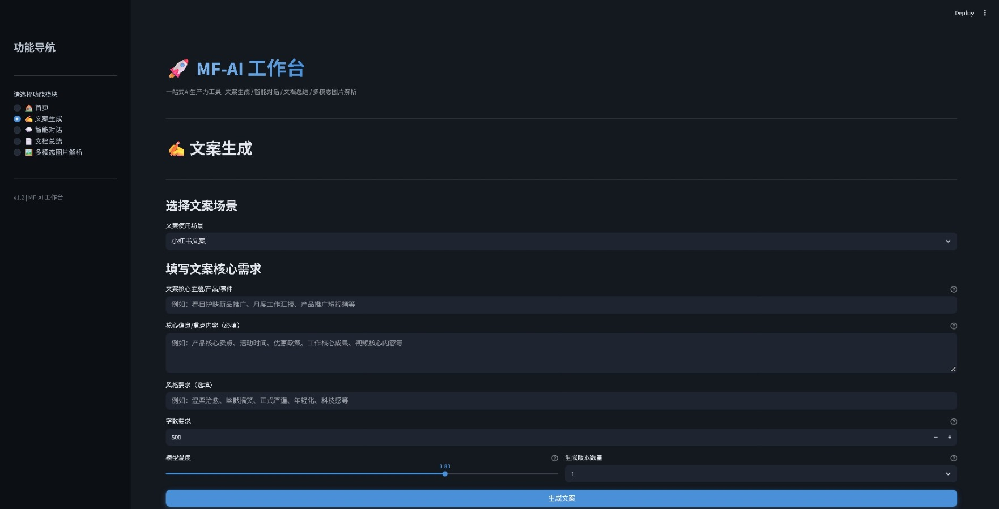
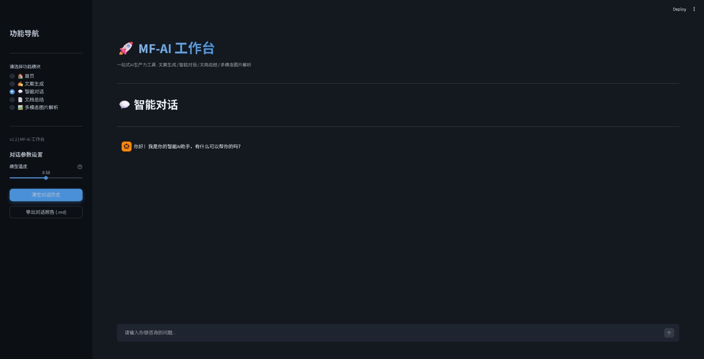
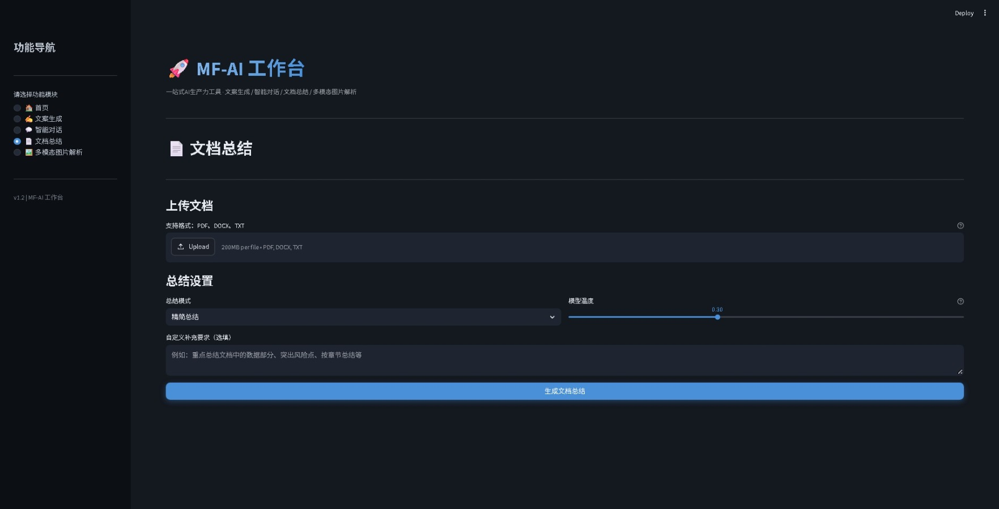
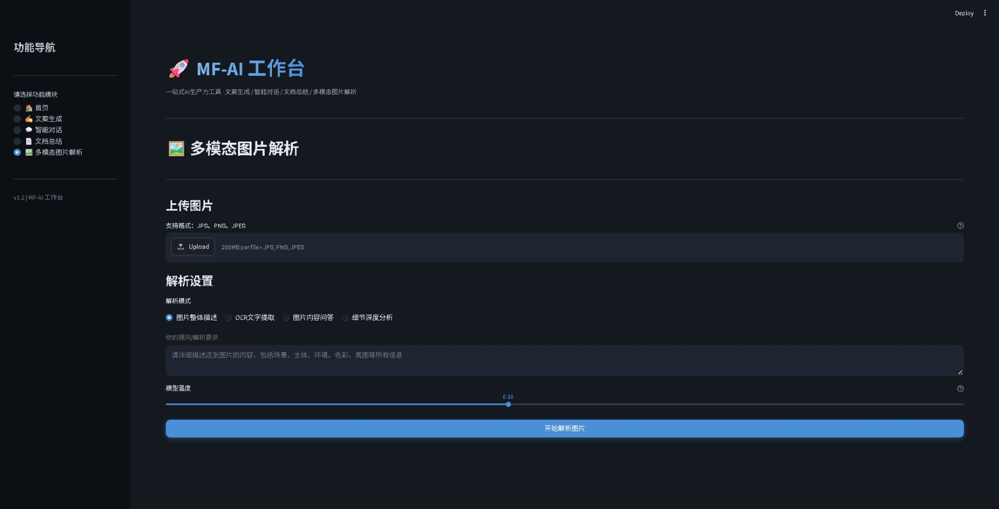

# MF-AI 工作台（MF-AI Platform）

> 一站式 AI 生产力工具平台：基于 Streamlit + 大模型 API，集成 **文案生成、智能对话、文档总结、多模态图片解析** 四大功能。兼容所有 OpenAI 格式接口（GPT / DeepSeek / 智谱 GLM / 通义千问）。

## ✨ 功能亮点

| 模块 | 核心能力 |
|------|----------|
| ✍️ 文案生成 | 6 大场景（小红书 / 公众号 / 短视频脚本 / 商务邮件 / 工作总结 / 通用），每场景专属 Prompt，支持风格、字数、多版本 |
| 💬 智能对话 | 多轮上下文记忆、流式打字机输出、本地 JSON 持久化（刷新不丢失）、一键导出对话报告 Markdown |
| 📄 文档总结 | 支持 PDF / DOCX / TXT，4 种总结模式（精简 / 详细 / 大纲 / 要点），可下载结果 |
| 🖼️ 多模态图片解析 | 支持 JPG / PNG / JPEG，整体描述 / OCR 提取 / 内容问答 / 细节分析 |

## 🆕 v1.2 迭代记录

1. **新增首页工作台**：应用打开即落地页，含欢迎横幅、四大功能卡片导航、快速开始引导，不再直接进入子模块。

### v1.1 迭代记录

1. **界面**：侧边栏按使用频率重排，高频「文案生成」置顶；全新深蓝黑主题（侧边栏 / 卡片 / 主背景四色分层）。
2. **功能**：智能对话新增「一键导出对话报告」，生成带时间戳、轮次编号的 Markdown 报告。
3. **参数**：系统 Prompt 增加「结论先行 + 分点论述 + 代码块 + 一句话总结」硬约束，默认 temperature 从 0.7 降到 0.5。

## 🛠️ 技术栈

| 技术 | 版本 | 用途 |
|------|------|------|
| Python | 3.10+ | 开发语言 |
| Streamlit | 1.33+ | Web 界面框架 |
| OpenAI SDK | 1.20+ | 大模型 API 对接（兼容 OpenAI 格式） |
| PyPDF2 | 3.0+ | PDF 解析 |
| python-docx | 0.8+ | Word 解析 |
| Pillow | 10.2+ | 图片处理与 base64 编码 |
| python-dotenv | 1.0+ | 环境变量管理 |
| Docker | 可选 | 容器化部署 |

## 📂 项目结构

```
mf-ai-platform/
├── app.py                     # 主入口：页面配置、主题、侧边栏导航
├── modules/
│   ├── home.py                # 首页工作台（落地页 + 功能导航）
│   ├── chat_module.py         # 智能对话（流式输出 + 持久化 + 导出报告）
│   ├── copywriting_gen.py     # 文案生成（6 场景化 Prompt）
│   ├── document_summary.py    # 文档总结（PDF/DOCX/TXT）
│   ├── multimodal_parser.py   # 多模态图片解析
│   └── llm_client.py          # 大模型客户端封装（单例）
├── .streamlit/config.toml     # 主题配置
├── .env.example               # 环境变量模板
├── requirements.txt
├── Dockerfile
└── docker-compose.yml
```

## 🚀 快速开始（本地运行）

### 1. 克隆项目

```bash
git clone https://github.com/qie0403/mf-ai-platform.git
cd mf-ai-platform
```

### 2. 创建虚拟环境并安装依赖

```bash
# Windows PowerShell
python -m venv venv
.\venv\Scripts\Activate.ps1

# macOS / Linux
python3 -m venv venv
source venv/bin/activate

# 安装依赖
pip install -r requirements.txt
```

### 3. 配置 API Key

```bash
cp .env.example .env
```

编辑 `.env`，填入你的 API Key 和模型：

```env
OPENAI_API_KEY="你的API密钥"
OPENAI_BASE_URL="https://open.bigmodel.cn/api/paas/v4"
CHAT_MODEL="GLM-4.7"
MULTIMODAL_MODEL="GLM-4.7"
```

> 用 DeepSeek 就把 BASE_URL 换成 `https://api.deepseek.com`，用 GPT 就换成官方地址，只要是 OpenAI 格式都能直接跑。

### 4. 启动

```bash
streamlit run app.py
```

浏览器自动打开 `http://localhost:8501`。

## 🐳 Docker 部署（可选）

```bash
# 先在项目根目录准备好 .env
docker-compose up -d --build
```

访问 `http://localhost:8501`，API Key 通过 `.env` 挂载，不打进镜像。

## 📸 功能截图

| 文案生成 | 智能对话 |
|---|---|
|  |  |

| 文档总结 | 图片解析 |
|---|---|
|  |  |

## 🔧 常见问题

- **页面文字发虚 / 主题异常**：确认 `.streamlit/config.toml` 存在，项目已强制深色主题。
- **报 API 调用失败**：检查 `.env` 的 KEY、BASE_URL、模型名是否匹配；网络是否能访问接口。
- **对话历史不消失**：这是持久化设计，记录在 `chat_history.json`，点侧边栏「清空对话历史」即可重置。

## 📌 后续规划

- [ ] 接入真实 RAG 检索（向量库 + 分块召回）
- [ ] 对话历史多会话管理
- [ ] 导出 PDF / Word 格式报告
- [ ] 接口流式输出的异常重试与熔断

## 📄 License

MIT
